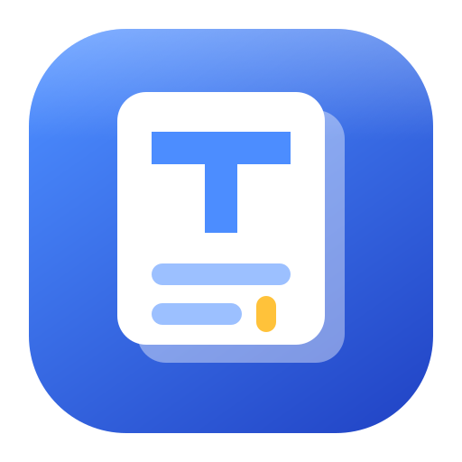

<p align="center">
  
</p>

<h1 align="center">AppThere Loki Text</h1>

<p align="center">
  <b>An open-source word processor for phones, tablets, Chromebooks and desktops.</b>
</p>

Loki Text pairs a [Compose Multiplatform](https://www.jetbrains.com/compose-multiplatform/) interface
with the Rust editing engine from [WordCraft](https://github.com/storytold/wordcraft), which this
repository is a fork of. It is the word processor of the AppThere Loki suite.

> [!NOTE]
> Loki Text is early (version 0.1.0). There are no published releases yet: build it from source.

## What it aims to be

- **Part of the AppThere Loki suite.** One of a family of AppThere apps, alongside others such as
  Loki Grid and Loki Decks. The suite shares [Loki Kit](loki-text/kit/README.md), the
  engine-independent part of the interface.
- **Mobile and tablet first.** One responsive app that works well with touch on a phone or tablet,
  and with a keyboard and mouse on a Chromebook or desktop.
- **A full word processor.** Every engine command reachable at every window size, aiming to match
  mainstream desktop word processors, with faithful `.docx` files.
- **Open, private and offline.** MIT or Apache-2.0, with no account. Writing and editing don't
  depend on a network connection.

These are goals. The next section says how far along each platform is.

## Status

| Platform | State |
|---|---|
| Android and ChromeOS | Release builds have been tried on a Chromebook and a Fire HD 8 tablet. Several features are still untried on a device ([#49](https://github.com/AppThere/loki-text/issues/49)). |
| Desktop (JVM) | Builds and runs; not yet tried as a whole ([#48](https://github.com/AppThere/loki-text/issues/48)). |
| iOS | Builds, and opens on the simulator; otherwise untried, including on a real device ([#47](https://github.com/AppThere/loki-text/issues/47)). |

All of the engine's commands can be reached from the app. Many open a form generated from their
parameters instead of a dedicated dialog
([#58](https://github.com/AppThere/loki-text/issues/58)). How this is measured, and what is
left, is in [loki-text/docs/parity.md](loki-text/docs/parity.md). Open work is in
[Issues](https://github.com/AppThere/loki-text/issues).

## Build Loki Text

You need Rust 1.95 or later (through [rustup](https://rustup.rs)) and JDK 21. Android builds also
need the Android SDK and NDK; iOS builds need macOS, Xcode and XcodeGen. Gradle comes with the
repository's wrapper.

```sh
git clone https://github.com/AppThere/loki-text
cd loki-text/loki-text

scripts/build-desktop.sh run                  # desktop: build and run
scripts/build-android.sh                      # Android: debug APK
VARIANT=Release scripts/build-android.sh      # Android: release APK, signed with the debug key
scripts/build-ios.sh run                      # iOS: build and start on a simulator (macOS only)
```

The Android script prints where it wrote the APK and the `adb install` command for it. It builds for
`arm64-v8a` by default; set `ABIS="arm64-v8a x86_64"` for both. The release APK's debug-key
signature is for local testing only, not distribution.

The app is English only unless you build it with translations from
[craft-i18n](https://github.com/storytold/craft-i18n): check it out at the commit in
[`craft-i18n.rev`](craft-i18n.rev) and set `CRAFT_I18N_DIR` to its absolute path.

For layout and design notes, see [loki-text/README.md](loki-text/README.md).

## Command line and agents

The repository also supports `wordcraft-cli`, which converts and edits documents without a window,
and runs an [MCP](https://modelcontextprotocol.io) server so AI agents can work on documents. Run
these from the repository root:

```sh
cargo run --release -p wordcraft-cli -- convert report.docx report.pdf   # docx, pdf, odt, rtf, html, md, tex, txt, png
cargo run --release -p wordcraft-cli -- text report.docx                 # plain text
cargo run --release -p wordcraft-cli -- inspect report.docx              # structure as JSON
cargo run --release -p wordcraft-cli -- run --script job.json            # run commands from a file

# MCP: the agent reads only inside the first folder and writes only inside the second
cargo install --path apps/wordcraft-cli
claude mcp add wordcraft -- wordcraft-cli mcp --automation-read-root DIR --automation-write-root DIR
```

See [MCP](docs/mcp.md) and [strict export](docs/strict-export.md), which refuses to write output
that would silently leave out a character or picture.

## Relationship to WordCraft

WordCraft is the engine's name, so the Rust crates, the command-line tool and much of the
documentation keep it. This fork continues to merge changes from
[storytold/wordcraft](https://github.com/storytold/wordcraft).

| Part | Where | Supported here |
|---|---|---|
| Loki Text, the Compose app | [`loki-text/`](loki-text/) | Yes |
| Command-line tool and MCP server | `apps/wordcraft-cli`, `crates/mcp` | Yes |
| Editing engine: document model, layout, file formats, rendering | `crates/` | Yes, as the base of both |
| WordCraft's desktop and web apps and their packaging | `apps/wordcraft`, `apps/wordcraft-web`, `crates/ui-egui`, `packaging/` | No: inherited from upstream, not released from this fork. For those apps, go to [upstream](https://github.com/storytold/wordcraft). |

Documents under `docs/`, along with [ROADMAP.md](ROADMAP.md), mostly describe WordCraft as it is
developed upstream. For Loki Text, start in [`loki-text/`](loki-text/).

## Contributing

Contributor and agent rules are in [AGENTS.md](AGENTS.md), which is shared with upstream. Report
security problems privately, as described in [SECURITY.md](SECURITY.md).

## License and credits

Loki Text and the WordCraft engine are offered under the [MIT License](LICENSE-MIT) or the
[Apache License 2.0](LICENSE-APACHE), at your option. The engine is the work of the WordCraft
authors and contributors; required copyright notices are in [NOTICE](NOTICE).

Fonts, icons, images and other assets keep their own open licenses. Each is listed with its author,
source and license in [ATTRIBUTION.md](ATTRIBUTION.md). Loki Text's ribbon icons are from
[Lucide](https://lucide.dev) (ISC License; some derived from Feather, MIT License).
